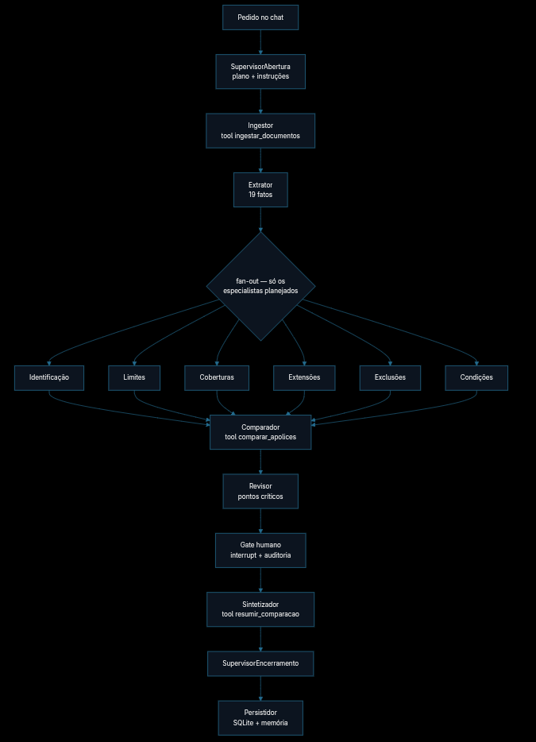

# D&O Policy Intelligence

## Relatório técnico do Projeto Final — InsurMinds

**Versão:** 2.0
**Data:** 6 de outubro de 2026
**Status:** arquitetura e implementação documentadas; suíte completa não revalidada nesta revisão
**Natureza do corpus:** documentos sintéticos autorais para demonstração acadêmica

## 1. Resumo executivo

O D&O Policy Intelligence é um MVP para receber, extrair, estruturar e comparar duas apólices D&O. A ingestão preserva o texto por página usando `pypdf` ou Tesseract OCR; a extração híbrida combina LLM e regras determinísticas para produzir os 19 campos do schema, com página e evidência. SQLite guarda documentos, páginas, fatos e comparações; epochDB indexa o texto não estruturado por página para recuperação semântica pelos especialistas. O framework de agentes é **LangGraph**, cuja API `StateGraph` coordena supervisor, seis especialistas, comparação determinística, revisão humana, síntese e persistência.

A solução foi concebida para atender ao Projeto Final do InsurMinds, que solicita um protótipo capaz de receber documentos, extrair conteúdo, organizar informações, armazená-las, permitir consulta, comparar pelo menos duas apólices e apresentar as principais diferenças com uso de IA Generativa e interface demonstrável [2].

> A saída é um apoio à análise documental. Não constitui parecer jurídico, subscrição, decisão de cobertura ou recomendação comercial.

## 2. Problema e objetivo

Apólices D&O são documentos extensos e jurídicos. A comparação manual de limites, coberturas, exclusões, franquias e condições exige localizar conceitos equivalentes em textos que podem variar em nomenclatura e organização. O objetivo do MVP é reduzir o trabalho mecânico de localização e alinhamento, preservando o trecho original e a página para revisão humana.

O projeto não pretende interpretar toda a legislação securitária nem cobrir todos os tipos de apólice. O foco didático é demonstrar uma arquitetura consistente, modular e explicável em um conjunto delimitado de categorias D&O.

## 3. Corpus documental

O repositório inclui `data/policies/Apolice_DO_A.pdf` e `data/policies/Apolice_DO_B.pdf`. São documentos sintéticos, autorais e redistribuíveis, criados especificamente para a demonstração. Eles não representam contratos reais nem devem ser utilizados para tomada de decisão securitária.

A estrutura dos documentos foi inspirada em categorias encontradas em condições gerais públicas de D&O, incluindo definições, objetivo, riscos excluídos, limites, franquia, custos de defesa, coberturas básicas, extensões, mudança de controle e período adicional de notificação [3]. A referência pública serviu como orientação de domínio; o texto entregue no repositório é original e sintético.

| Documento | Páginas | Características demonstradas |
|---|---:|---|
| Apólice A | 3 | Limite de R$ 10 milhões, franquia de R$ 50 mil, território sem EUA/Canadá, cobertura C não incluída, período adicional de 24 meses. |
| Apólice B | 3 | Limite de R$ 15 milhões, franquia de R$ 100 mil, território mundial incluindo EUA/Canadá, cobertura C incluída, período adicional de 36 meses. |

## 4. Arquitetura da solução

O fluxo é composto por componentes com responsabilidades separadas:

| Componente | Responsabilidade | Implementação |
|---|---|---|
| Recepção | Validar extensão, existência e quantidade de documentos | `seguramente_final/ingest.py` |
| Ingestor e OCR | Ler PDF/imagem, preservar páginas e aplicar OCR em páginas com camada textual insuficiente | `ingest.py`, `tools/ocr.py`, `pypdf`, `pytesseract`, `pdf2image` |
| Schema | Definir campos comparáveis e categorias D&O | `seguramente_final/schema.py` |
| Extração híbrida | Extrair os 19 campos por LLM; completar omissões com regras e marcar divergências como ambíguas | `tools/extrator.py`, `rules.py`, `models.py` |
| Persistência | Guardar documentos, páginas, fatos e comparações | `seguramente_final/storage.py` com SQLite |
| Memória documental | Indexar texto por página, metadados e relações; recuperar trechos por apólice | `agentes/memoria.py` com epochDB |
| Orquestração | Planejar especialistas, executar fan-out, revisar e pausar para humano | `agentes/grafo.py`, `fluxo.py`, `supervisor.py`, `gate.py` |
| Comparador | Alinhar duas apólices pelo schema e classificar diferenças | `seguramente_final/compare.py` |
| Síntese e apresentação | Resumir pedido, achados e evidências; exibir tabela, páginas e status do grafo | `tools/resumidor.py`, `app.py` |

O pipeline clássico (`analyze_policies`) permanece disponível para processamento determinístico/CLI. A interface principal usa o grafo LangGraph. Em ambos, a comparação por schema continua determinística; a LLM ajuda na extração, planejamento e síntese, sem substituir os resultados rastreáveis.

O diagrama reproduz o fluxo de agentes apresentado no README. `FLUXO` define as etapas lineares e `FANOUT` despacha, em paralelo, somente os especialistas selecionados pelo supervisor.



**Framework e técnicas de agentes.** LangGraph foi escolhido para modelar o processamento como grafo de estado, em vez de uma cadeia única de prompts. `EstadoAnalise` é um blackboard JSON-safe; o registro `@agente` alimenta grafo e interface; `FANOUT` faz roteamento condicional e execução paralela dos especialistas; reducers agregam seus achados. O gate usa `interrupt` e `Command(resume=...)` para human-in-the-loop, com checkpoint por thread. Contratos e allowlist limitam as ferramentas que cada nó pode acionar; a telemetria acompanha etapas e ferramentas com origem, duração e métricas sem registrar texto das apólices.

## 5. Agentes e responsabilidades

A solução organiza o processamento em componentes especializados, conforme a orientação do edital [2].

| Componente/agente | Responsabilidade | Saída principal | Limite |
|---|---|---|---|
| `SupervisorAbertura` | Consulta memória histórica e planeja especialistas via LLM; usa keywords offline como fallback | `plano` e instruções por especialista | Roteia para um catálogo fixo; não altera o schema |
| Ingestor/OCR | Valida arquivos, lê páginas e indexa texto no epochDB | Documentos JSON-safe, texto por página e estado da indexação | OCR é melhor esforço; texto reconhecido pode conter erros |
| `ExtratorNode` | Executa extração por LLM com complemento determinístico | 19 `PolicyFact` por apólice, estatísticas e fallback | Regras usam aliases e não substituem interpretação securitária |
| Seis especialistas | Analisam identificação, limites, coberturas, extensões, exclusões e condições em paralelo | Veredito determinístico/LLM, achados e trechos citados | Cada especialista trabalha apenas seu domínio e contexto recuperado |
| `ComparadorNode` | Compara valores normalizados pelo par categoria/label | 19 `ComparisonRow` com status, evidências e páginas | Não decide qual cobertura é melhor |
| `RevisorNode` / `GateHumano` | Detecta lacunas, ambiguidades e divergências materiais; pausa para decisão | Pontos críticos e auditoria JSONL | A decisão final é humana |
| `SintetizadorNode` / `SupervisorEncerramento` | Sintetiza comparação, pedido, achados e evidências; tem fallback offline | Resumo final e contagens | Não emite parecer jurídico ou recomendação comercial |
| `PersistidorNode` | Grava dados canônicos e memória da análise | SQLite, resumo histórico e relações de análise | Memória histórica não substitui o texto das apólices |

## 6. Schema de dados D&O

O schema delimita 19 campos comparáveis. Cada campo possui categoria, label, valor textual, status, confiança, página, evidência e valor normalizado.

| Categoria | Campos |
|---|---|
| Identificação | Seguradora; vigência; âmbito geográfico |
| Limites | Limite máximo de responsabilidade; limite agregado |
| Retenções | Franquia / retenção |
| Coberturas | Cobertura A; Cobertura B; Cobertura C; custos de defesa |
| Extensões | Custos de investigação; novas subsidiárias; período adicional de notificação |
| Exclusões | Fraude ou dolo; danos corporais ou materiais; poluição |
| Condições | Notificação de reclamações; mudança de controle; acordos e consentimento |

Os estados possíveis são `present`, `not_found`, `ambiguous` e `not_applicable`. A aplicação não converte ausência de localização em exclusão de cobertura. Essa distinção é essencial para evitar conclusões jurídicas indevidas.

Exemplo de fato estruturado:

```json
{
  "category": "limites",
  "label": "Limite máximo de responsabilidade",
  "value": "R$ 10.000.000,00",
  "status": "present",
  "confidence": 0.98,
  "page": 2,
  "evidence": "LIMITE MÁXIMO DE RESPONSABILIDADE: R$ 10.000.000,00"
}
```

## 7. Extração de PDF e OCR

Para PDF pesquisável, o sistema utiliza `pypdf` e preserva o texto por página. Quando uma página retorna menos de 20 caracteres, o pipeline tenta convertê-la em imagem com `pdf2image` e aplica `pytesseract` nos idiomas português e inglês. Cada página registra o método utilizado: `pdf-text`, `ocr` ou estado vazio.

Para imagens PNG, JPG, JPEG, TIFF e similares, o sistema aplica OCR diretamente. Arquivos com extensão não suportada, vazios ou inexistentes são rejeitados com erro controlado.

## 8. Uso de IA Generativa e extração híbrida

`motor_llm/` implementa um contrato `ChatJson` e provedores OpenAI, Groq e Google/Gemini. As chamadas são feitas pela aplicação com chaves em variáveis de ambiente/`.env`; credenciais não entram no estado do LangGraph nem nos checkpoints. O motor registra provedor/modelo e contagem de tokens, aplica concorrência limitada e tenta novamente apenas falhas transitórias. Erros de cota são redigidos e tratados como indisponibilidade, sem repetição inútil.

Na extração, a LLM recebe texto extraído das páginas e os labels autorizados do schema. O resultado é normalizado e alinhado aos 19 campos. Se a resposta vier parcial, cada campo omitido é completado pelo `RuleBasedExtractor`; se LLM e regra trouxerem valores divergentes, o fato recebe status `ambiguous`, preserva ambas as evidências e pode acionar o gate humano. Campos ainda não localizados permanecem `not_found`; não são convertidos em ausência de cobertura.

O extrator envia até 12.000 caracteres do texto concatenado por documento em uma única chamada. A cobertura final é registrada por documento (`campos LLM`, complemento por regras, conflitos e status). Esse limite é uma limitação para apólices longas e pode exigir extração em lotes/seções numa evolução futura. A comparação por schema permanece determinística; a LLM não é a autoridade para classificar igualdade ou divergência.

O supervisor pode usar LLM para planejar; sem resposta válida, roteia por keywords normalizadas. Especialistas usam prompts separados, fatos estruturados e trechos do epochDB. O resumo final recebe o pedido original, linhas comparativas, achados e evidências recuperadas; se falhar, é produzido um resumo offline baseado nas diferenças.

## 9. Comparação e recuperação contextual

O comparador alinha os fatos de A e B pelo par `categoria + label` e produz 19 linhas com status `igual`, `diferente`, `ausente_em_a`, `ausente_em_b`, `ambigua` ou `ambos_ausentes`. Valores normalizados e regras determinísticas permitem reproduzir a classificação; a interface exibe valores, páginas e evidências.

No fluxo agente, após o supervisor definir os especialistas, cada um consulta o epochDB separadamente para cada apólice, filtrando pelo ID do documento e pela versão ativa dos trechos. Até duas páginas relevantes por documento são injetadas no veredito. Se não houver resultado vetorial, o especialista usa as evidências estruturadas disponíveis; a ausência de trecho não é interpretada como ausência de cobertura.

## 10. Persistência: SQLite, epochDB e checkpoints

SQLite é a fonte canônica estruturada. As tabelas `documents`, `pages`, `facts` e `comparisons` guardam identidade/origem, texto e método de extração por página, fatos com status/confiança/evidência, e resultados comparativos. Isso mantém o pipeline determinístico e permite auditoria sem depender da busca vetorial.

### 10.1 Memória vetorial e grafo epochDB

O epochDB [1] recebe o texto não estruturado produzido por `pypdf`/OCR, não só os resumos históricos. A unidade atual de indexação é uma página: o payload contém o texto e metadados de `document_id`, nome, página, método de extração e hash. O identificador do átomo é estável por documento/página/conteúdo; um manifesto permite pular páginas inalteradas e restringir a consulta à versão ativa quando uma página muda.

Cada página também cria relações `documento → página → trecho`. O epochDB aplica embedding local (`all-MiniLM-L6-v2` por padrão) e mantém o grafo de entidades/relacionamentos. A recuperação dos especialistas usa `query()` semântico com filtro por apólice e sem expansão multi-hop (`expand_hops=0`); as relações ficam indexadas, mas a resposta atual é baseada nos hits vetoriais filtrados e em fatos do SQLite.

`MemoriaLocal` em JSONL guarda resumos de análises anteriores e triplas de assunto; não é o repositório das páginas das apólices. Se o epochDB falhar ao inicializar, a aplicação informa o modo degradado e mantém as regras/fatos disponíveis, mas não deve afirmar que fez recuperação vetorial.

### 10.2 Checkpointer do LangGraph

`EpochDBCheckpointer` é um componente distinto da memória vetorial. É uma implementação vendorizada/adaptada para persistir checkpoints de execução em JSON sob `data/checkpoints/<thread_id>/`; não armazena embeddings nem substitui o epochDB. As credenciais são injetadas no cliente LLM e não fazem parte do estado serializado.

## 11. Interface de demonstração

A interface Streamlit possui duas modalidades. No modo corpus sintético, utiliza as duas apólices incluídas no projeto. No modo upload, aceita dois arquivos em PDF ou imagem e salva cópias temporárias para a execução.

A demonstração visual apresenta os documentos recebidos, contagem de páginas e métodos de extração; resumo comparativo; consulta por campo; tabela lado a lado; evidências por página; e limitações. O sistema exige duas apólices para executar a comparação.

## 12. Validação e evidências

O repositório inclui demos JSON do corpus sintético em `evidence/` e testes para leitura/OCR, cobertura do schema, comparação, SQLite, fallback de LLM, indexação/recuperação epochDB, especialistas, gate, logs e interface. Na revisão de 6 de outubro de 2026, Ruff passou nos módulos e testes alterados e probes isolados confirmaram: resposta LLM parcial é completada para 19 fatos; conflito LLM/regra vira `ambiguous`; a telemetria registra cobertura sem imprimir texto documental.

A suíte pytest completa não foi executada nesta revisão: o interpretador configurado no venv local aponta para um executável ausente neste ambiente. Assim, os resultados históricos/demo não devem ser apresentados como validação integral do código atual. As evidências de demonstração são `../evidence/demo_analysis_offline.json` e `../evidence/demo_analysis_openai.json`; não contêm chaves de API.

## 13. Instalação e execução

O README da raiz contém o quick start completo para Docker Compose e ambiente virtual. Localmente, `requirements.txt` instala runtime (incluindo `epochdb`, `hnswlib` e `sentence-transformers`); `requirements-dev.txt` acrescenta `pytest`, Ruff e ReportLab para testes/geração do corpus.

```bash
python3 -m venv .venv
source .venv/bin/activate
python -m pip install --upgrade pip
pip install -r requirements-dev.txt
cp .env.example .env
streamlit run app.py --server.port 8501 --server.fileWatcherType none
```

No Docker, `docker compose up --build -d` inicia a mesma interface em `http://localhost:8501`. A imagem contém aplicação e PDFs sintéticos; dados de execução, `.env` e cache de embeddings ficam em volumes. O modo `offline` não exige credencial; provedores OpenAI/Groq/Google usam chaves em `.env` ou configuradas na interface.

## 14. Limitações conhecidas

O corpus é sintético e não representa apólices comerciais. O OCR pode produzir erros em tabelas, colunas, números e caracteres jurídicos. O schema cobre um conjunto delimitado de campos e não pretende interpretar todos os endossos, condições particulares ou conflitos de cláusulas. A comparação textual e normalizada é apoio à revisão; não substitui especialista em seguros ou advogado.

O extrator LLM recebe até 12.000 caracteres concatenados por documento; políticas maiores podem precisar de extração por seção. O OCR pode errar tabelas, colunas, números e caracteres jurídicos. As regras offline usam aliases literais e são complementares, não substitutas de validação especializada. A busca do epochDB recupera até duas páginas por documento/especialista, e a expansão multi-hop do grafo não está ativada. O schema cobre 19 campos D&O e a comparação implementada é para duas apólices; os documentos do corpus são sintéticos.

O produto não implementa autenticação, alta disponibilidade, controle multiusuário, integração com seguradoras nem assinatura digital. A saída não é parecer jurídico, subscrição, decisão de cobertura ou recomendação comercial. Essas limitações são compatíveis com o escopo acadêmico do edital [2].

## 15. Evoluções futuras

As evoluções prioritárias são: ampliar a extração em seções para documentos longos; calibrar confiança com corpus rotulado; permitir correção humana dos fatos; avaliar expansão multi-hop do epochDB; medir recall/precisão da recuperação e qualidade das citações; suportar versões/múltiplas apólices e exportar relatório comparativo.

## 16. Rastreabilidade ao edital

| Requisito | Evidência no projeto |
|---|---|
| Leitura de PDF ou imagem | `ingest.py`, `pypdf`, `pytesseract` e upload Streamlit |
| Extração automática | `tools/extrator.py`: provedores ChatJson + complemento `RuleBasedExtractor`; 19 fatos por apólice |
| Estruturação dos dados | `schema.py`, `PolicyFact` e JSON de evidência |
| Armazenamento estruturado | SQLite em `storage.py` para páginas, fatos e comparações |
| Memória de texto não estruturado | `agentes/memoria.py`: epochDB, embeddings por página, metadados e relações |
| Comparação de pelo menos duas apólices | `compare.py`, demo e tabela de 19 campos |
| Principais diferenças ao usuário | DataFrame comparativo e evidências por página |
| Uso de IA Generativa | Provedores OpenAI/Groq/Google para planejamento, extração, vereditos e síntese |
| Orquestração e revisão | LangGraph, supervisor, seis especialistas, gate humano e retomada |
| Observabilidade | Logs estruturados por thread/componente, duração, cobertura e fallback; sem texto de apólice/chaves |
| Interface demonstrável | `app.py` com Streamlit e chat do supervisor |
| Relatório técnico | Este documento em PDF e Markdown |
| Pitch Deck e vídeo | `Projeto_Final_Artefatos/InsurMinds_Projeto_Final.pptx` e `.mp4` |
| Container | `Dockerfile`, `compose.yaml` e `.dockerignore`; corpus sintético embutido e dados em volumes |
| Repositório e ZIP | README, LICENSE, pacote e repositório público |

## Referências

[1]: https://github.com/jersobh/epochdb "EpochDB — memória vetorial e grafo de conhecimento"

[2]: `Desafios.pdf`, Instituto de Inteligência Artificial Aplicada — I2A2, páginas 20–25, edital fornecido para o Projeto Final.

[3]: https://www.berkley.com.br/wp-content/uploads/2022/03/CG_DEO.pdf "Berkley — Condições Gerais de Responsabilidade Civil para Conselheiros, Diretores e/ou Administradores — D&O"
