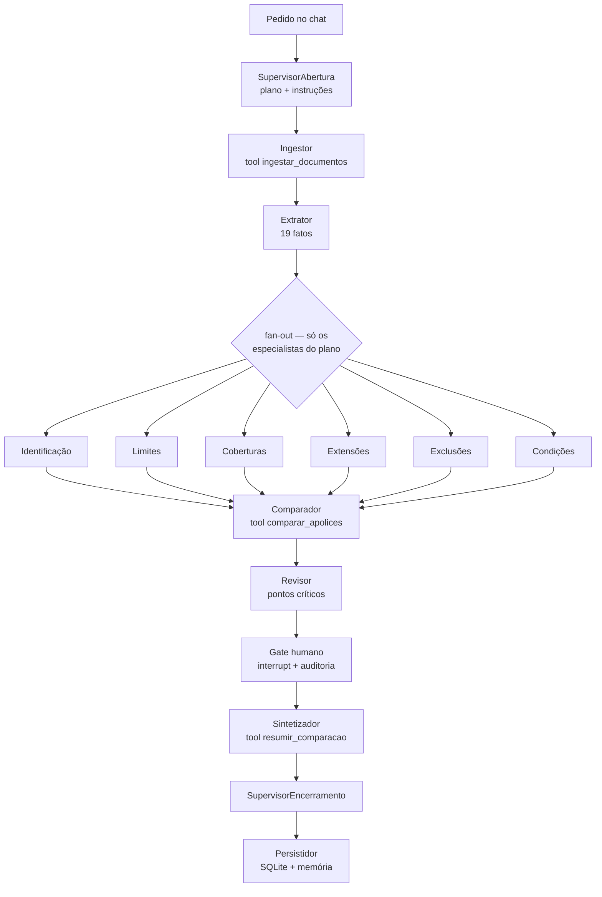

# D&O Policy Intelligence

## Projeto Final — InsurMinds

MVP para receber, extrair, estruturar, consultar e comparar duas apólices de seguro D&O, apresentando diferenças com evidências por página — com **orquestração de agentes (LangGraph)**: um supervisor intermedia o usuário e seis especialistas, o gate humano registra a decisão e o front exibe a orquestra em tempo real.

> A aplicação é um protótipo acadêmico. A saída apoia a análise documental e não constitui parecer jurídico, subscrição ou decisão de cobertura.

## Início rápido com Docker

Com Docker Engine e Docker Compose instalados, execute na raiz do repositório:

```bash
cp .env.example .env
docker compose up --build -d
```

Abra <http://localhost:8501>. O modo offline funciona sem chaves; para usar um provedor LLM, configure a chave correspondente em `.env` antes de subir o container. Consulte [Executar com Docker](#executar-com-docker-recomendado) para logs, volumes persistentes e encerramento.

## Integrantes

| Nome | E-mail |
|---|---|
| `Daniel Correa Rodrigues` | `[naortier@gmail.com]` |
| `Adelson N. de Almeida` | `[daniellcrsg10@gmail.com]` |
| `Denis Barreira Batista` | `[denis.batista@susep.gov.br]` |
| `Sami Knoblich Goldstein` | `[samikgoldstein@gmail.com]` |
| `Eliezer Henrique da Silva Paula` | `[contato@nex2u.ia.br]` |

## O que o projeto demonstra

| Requisito do Projeto Final | Evidência |
|---|---|
| Ler PDF ou imagem | `seguramente_final/ingest.py`, `pypdf`, OCR e upload Streamlit |
| Extrair conteúdo automaticamente | Provider offline determinístico e provedores OpenAI, Groq e Google (BYOK) |
| Estruturar informações | Schema com 19 campos, status, confiança, página e evidência |
| Armazenar dados | SQLite para documentos, páginas, fatos e comparações; epochDB para texto vetorizado e relações; JSONL para resumos históricos |
| Comparar duas apólices | `seguramente_final/compare.py` e tabela na interface |
| Apresentar diferenças | Resumo, busca, tabela lado a lado e evidências expansíveis |
| Utilizar IA Generativa | Extração JSON, veredito dos especialistas e resumo comparativo; roteamento do supervisor com fallback offline |
| Interface demonstrável | `app.py` com Streamlit — chat com o supervisor e orquestra de agentes ao vivo |

## Módulo de agentes (modo orquestra)

O modo agentes executa a comparação como um **grafo LangGraph** de 15 agentes registrados por registry/decorator (`@agente`) sobre um fluxo declarativo (`FLUXO` + `FANOUT`):

- **Supervisor** — intermedia o usuário: consulta a memória de análises anteriores (`memoria_contexto`), monta o plano de especialistas com LLM (fallback determinístico por keywords, sem acento-sensível) e redige instrução individual por especialista; reencerra a análise com a decisão do gate.
- **Seis especialistas** — identificação, limites, coberturas, extensões, exclusões e condições; cada um com `ContratoAgente` (papel, prompt e ferramentas ⊆ allowlist) e veredito por regra + LLM opcional (com bloco de memória no prompt quando há histórico).
- **Gate humano** — `interrupt` do LangGraph com pontos críticos, formulário de decisão no chat e auditoria em `evidence/gate_audit_<thread>.jsonl`.
- **Ferramentas** — allowlist de 4 tools (`ingestar_documentos`, `extrair_texto_ocr`, `comparar_apolices`, `resumir_comparacao`) executadas só via dispatcher `executar_ferramenta` (contrato → allowlist → origem do agente na telemetria).
- **Telemetria e memória** — eventos por thread (nós + tools) alimentam o front ao vivo; o checkpointer do LangGraph persiste estados em JSON. O epochDB, instalado pelo `requirements.txt`, indexa o texto extraído por página com metadados e relações documento→página→trecho. Especialistas consultam cada apólice separadamente e recebem trechos com evidência e número da página; SQLite continua sendo a fonte canônica dos documentos, fatos e comparações. `MemoriaLocal` (JSONL) mantém resumos históricos; se o epochDB não inicializar, a interface informa a degradação e as regras determinísticas continuam disponíveis.
- **Front** — três divisões: sidebar de configs (corpus, **checkbox “Acionar OCR nas páginas (simulação)”**, provedor `offline`/`openai`/`groq`/`google`, modelo, chave e **botão “💾 Salvar no .env”** com confirmação), chat com o supervisor (pedido, gate e resposta) e orquestra semicircular com estados por quadrante (pronto, executando com glow, ok, pausa, falhou, fora do plano), progresso `N/M ✓`, badge `⚡n` de ferramentas, ícone de tipo em cada cartão (🤖 agentes, 🔨 tools) e pills que abrem o cartão mínimo de detalhe (legenda do tipo + status).

**Destaques de engenharia**: TDD por fase (190 testes + `ruff`), padrão registry/decorator — criar um agente novo é 1 classe + 1 linha no `FLUXO` —, allowlist de ferramentas imposta em código, credenciais fora do estado/checkpoint e modo offline determinístico para demonstração reprodutível.

## Executar com Docker (recomendado)

Requer Docker Engine e Docker Compose. A imagem inclui apenas o app, os módulos Python e as duas apólices sintéticas; relatórios, documentos de curso, evidências, testes, scripts e materiais multimídia ficam fora do build. SQLite, checkpoints, memória, auditoria, chaves salvas pela interface e cache do modelo ficam em volumes persistentes, não na imagem.

```bash
cp .env.example .env
docker compose up --build -d
```

Acesse <http://localhost:8501>. Os logs estruturados de cada etapa ficam disponíveis com `docker compose logs -f app`; ajuste a verbosidade com `SEGURAMENTE_LOG_LEVEL` no `.env` (`INFO`, `WARNING` ou `DEBUG`). A configuração limita o armazenamento do Docker a três arquivos de 10 MB e reduz as barras repetitivas de progresso de embeddings. Para parar, use `docker compose down`; o container recebe sinal de encerramento e tem até 45 segundos para finalizar. Os volumes são preservados. `docker compose down -v` também apaga dados, checkpoints, memória, chaves salvas pela interface e cache de modelos.

O modo offline funciona sem chave de provedor. Para IA generativa, preencha `OPENAI_API_KEY`, `GROQ_API_KEY` ou `GOOGLE_API_KEY` (alternativa `GEMINI_API_KEY`) em `.env`. O Compose passa essas variáveis ao container; a imagem não contém o arquivo `.env`. Chaves salvas pela sidebar ficam no volume de dados com permissão `0600`.

Na primeira análise, o epochDB baixa o modelo local de embeddings (`all-MiniLM-L6-v2` por padrão); o volume `model-cache` persiste tanto `~/.cache/epochdb_models` quanto o cache do Hugging Face. `EPOCHDB_EXTRACTION_MODEL` controla a criação de triplas (`local` por padrão). Se a inicialização do epochDB falhar, a interface indica a degradação e a comparação determinística continua disponível.

## Executar em ambiente virtual

Requer Python 3.11 ou superior. Em Ubuntu/Debian, instale Tesseract para português/inglês, Poppler para PDFs escaneados e compilador C++ para o índice `hnswlib` do epochDB:

```bash
sudo apt-get update
sudo apt-get install -y build-essential libgomp1 poppler-utils tesseract-ocr tesseract-ocr-eng tesseract-ocr-por
python3 -m venv .venv
source .venv/bin/activate
python -m pip install --upgrade pip
pip install -r requirements-dev.txt
cp .env.example .env
```

Para instalar somente as dependências de execução, use `pip install -r requirements.txt`. Para iniciar a interface:

```bash
streamlit run app.py --server.port 8501 --server.fileWatcherType none
```

O `SEGURAMENTE_DATA_DIR` altera o diretório de SQLite, checkpoints, memória e auditoria; sem essa variável, o padrão continua sendo `<projeto>/data`. Os logs usam `thread_id`, componente/etapa, duração, IDs dos documentos, páginas e contagens de extração/comparação; chamadas LLM incluem provedor/modelo e tokens. Conteúdo de apólices, prompts e chaves não são registrados. Ajuste a verbosidade com `SEGURAMENTE_LOG_LEVEL` (padrão `INFO`); avisos do Sentence Transformers continuam visíveis.

Chamadas LLM tentam novamente falhas transitórias (429/5xx/timeout: até cinco tentativas com backoff, jitter e `Retry-After`), limitam a duas requisições simultâneas por processo e desistem imediatamente quando o provedor sinaliza cota esgotada. O chat informa o motivo do modo degradado em vez de apresentar sucesso silencioso.

Versão sem interface (pipeline completo, grava JSON em `evidence/`):

```bash
./.venv/bin/python scripts/run_demo.py --provider offline
```

Por padrão, a interface usa as duas apólices sintéticas autorais incluídas em `data/policies`. Para testar outros documentos, desmarque “Usar corpus sintético incluso” e faça upload de dois PDFs ou imagens. A opção **“Acionar OCR nas páginas (simulação)”** força o reconhecimento também em páginas com texto nativo — o card 🔨 `extrair_texto_ocr` acende no painel de Orquestração e o texto nativo é preservado (análise inalterada).

Na sidebar, escolha o provedor (`offline` não exige chave), o modelo (default por provedor: `gpt-5-mini`, `llama-3.3-70b-versatile`, `gemini-3.5-flash`) e, se quiser, digite a API key — clique em “💾 Salvar no .env” (ou deixe o auto-save) e acompanhe o status mascarado; chave e modelo ficam gravados no `.env` (fora do git) e reaproveitados nas próximas execuções.

No chat, descreva o pedido ao supervisor (ex.: “compare os limites e as coberturas”); a orquestra acende quadrante por quadrante, o gate abre quando há pontos críticos e a decisão humana retoma o grafo até o resumo final com tabela.

## Gerar evidências pela linha de comando

Modo offline:

```bash
python3 scripts/run_demo.py --provider offline --output evidence/demo_analysis_offline.json
```

Modo com IA:

```bash
python3 scripts/run_demo.py --provider openai --output evidence/demo_analysis_openai.json
```

O ambiente de validação utilizou `gpt-5-mini`. O resultado registra documentos, páginas, fatos, diferenças, evidências, provider e modelo; não registra chaves.

## Testes

```bash
python -m pytest -q
ruff check .
```

`requirements-dev.txt` instala também pytest, Ruff e ReportLab, usado pelo script de geração do corpus sintético. A suíte cobre o pipeline PDF/OCR, comparação e SQLite, provedores LLM, indexação e recuperação epochDB, fluxo LangGraph, gate e interface Streamlit.

## Arquitetura

Duas camadas sobre o mesmo domínio:

```text
camada clássica (pipeline.py)
PDF/imagem → ingestão nativa/OCR → texto por página → extração estruturada
          → validação de evidências → SQLite → comparação → interface

camada de agentes (LangGraph)
pedido no chat → SupervisorAbertura (plano + instruções)
          → Ingestor → Extrator → fan-out dos especialistas do plano
          → Comparador → Revisor → ⚖ Gate humano (interrupt + auditoria)
          → Sintetizador → SupervisorEncerramento → Persistidor
```



Estrutura detalhada (contrato, registro, fluxo, estado e gate) no [SDD](docs/SDD.md); o pipeline clássico e a validação estão no [Relatório Técnico](docs/Relatorio_Tecnico_Projeto_Final.pdf) — o diagrama fonte do fluxo clássico está em `docs/assets/architecture.mmd`.

## Corpus

`data/policies/Apolice_DO_A.pdf` e `Apolice_DO_B.pdf` são documentos sintéticos, autorais e redistribuíveis, criados para demonstrar diferenças de limites, franquias, território, coberturas, exclusões e condições. Eles não representam contratos de seguradoras reais.

A referência pública de domínio utilizada durante a modelagem foi a [Condições Gerais D&O da Berkley](https://www.berkley.com.br/wp-content/uploads/2022/03/CG_DEO.pdf). O texto incluído neste repositório não é uma cópia desse documento.

## Estrutura de entrega

```text
.
├── app.py                          # Streamlit: sidebar, chat com supervisor e orquestra
├── data/policies/                  # corpus sintético e SQLite local
├── docs/                           # relatório, SDD.md, pitch e arquitetura
├── evidence/                       # JSONs, auditoria do gate e imagens de evidência
├── Projeto_Final_Artefatos/        # Pitch Deck, vídeo e auxiliares
├── seguramente_final/              # módulos do MVP
│   ├── agentes/                    # grafo LangGraph: contrato, registro, fluxo, gate, memória
│   ├── motor_llm/                  # provedores openai/groq/google (BYOK) + offline
│   ├── tools/                      # registry + allowlist das ferramentas
│   └── *.py                        # pipeline clássico: ingest, compare, storage, models...
├── scripts/                        # geração de corpus e demonstração
├── tests/                          # 190 testes (TDD)
├── .env.example
├── LICENSE
├── README.md
└── requirements.txt
```

## Artefatos multimídia

A pasta `Projeto_Final_Artefatos` contém os arquivos exigidos pelo edital:

- `InsurMinds_Projeto_Final.pptx`;
- `InsurMinds_Projeto_Final.mp4`;
- `architecture.png` e `demo_analysis_openai.json` como auxiliares.

## Licença

MIT License. Consulte o arquivo `LICENSE`.
